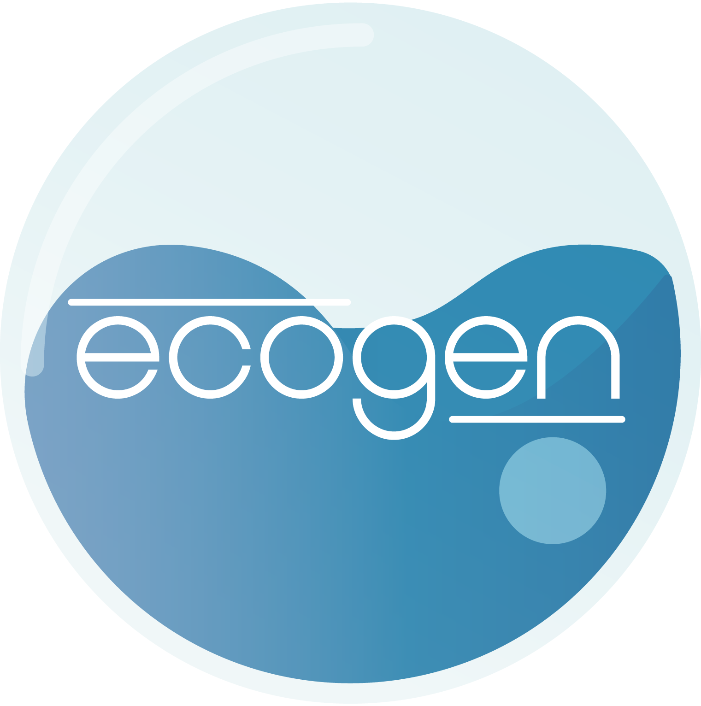

<div align="center">
  <a href="https://code-mphi.github.io/ECOGEN/">
    
  </a>
  <h3>An open-source CFD platform for numerical simulation of multiphase compressible flows</h3>
</div>

**ECOGEN** is a CFD plateform written in C++ object oriented programming langage. It is dedicated to numerical simulation of compressible multiphase flows. It has the vocation to share academics researches in the multiphase flow field in direction to other academics but also for industrials, students, etc.

* Official website: https://code-mphi.github.io/ECOGEN/
* Official documentation: https://code-mphi.github.io/ECOGEN/docs/sphinx_docs/index.html
* API documentation: https://code-mphi.github.io/ECOGEN/docs/doxygen_docs/index.html

## What can I do with it ?

With **ECOGEN** you can solve:

* Interface problems between pure or multicomponents fluids and mixtures of multiphase flows.
* Flow problems involving surface tension, heat and mass transfers for evaporating and condensing flow, cavitation.
* Wave propagation problems in strongly unsteady situations using a specific Adaptative Mesh Reffinement.
* Complex flow problems on unstructured grids.

Visit the gallery for examples: https://code-mphi.github.io/ECOGEN/gallery/

## Start with ECOGEN

The better way to start with **ECOGEN** is to follow installation instructions on the official documentation website: https://code-mphi.github.io/ECOGEN/docs/sphinx_docs/Chap2_installation_Chapter.html

Then you can follow the dedicated tutorial to run your first test: https://code-mphi.github.io/ECOGEN/docs/sphinx_docs/Chap4_1startWithECOGEN.html

## License

[](https://www.gnu.org/licenses/gpl-3.0)

ECOGEN is free software: you can redistribute it and/or modify it under the terms of the GNU General Public License as published by the Free Software Foundation, either version 3 of the License, or (at your option) any later version.
ECOGEN is distributed in the hope that it will be useful, but WITHOUT ANY WARRANTY; without even the implied warranty of MERCHANTABILITY or FITNESS FOR A PARTICULAR PURPOSE. See the GNU General Public License for more details http://www.gnu.org/licenses.

## Project leadership

This project is led by a dedicated team of researchers, maintainers and developers:

- [Kevin Schmidmayer](https://kevinschmidmayer.github.io/) - Inria Bordeaux, Universté de Pau et des Pays de l'Adour.
- Fabien Petitpas - Aix-Marseille Université.

## Authors and acknowledgments

Find the complete list of authors and acknowledgments here: https://code-mphi.github.io/ECOGEN/docs/sphinx_docs/Chap7_license.html

## Citation

When using one of the latest ECOGEN version, please cite both following references to acknowledge the work of all contributors:

Schmidmayer K., Petitpas F., Daniel E., Cazé J., Froehly A., Dorschner B., Le Martelot S., Favrie N., Gadiri F. Z., Schropff S., Ade-Onojobi A. (2025). ECOGEN. *HAL*. [](https://hal.science/hal-05023172)

Schmidmayer, K., Petitpas, F., Le Martelot, S. & Daniel, E. (2020). ECOGEN, an open-source tool dedicated to multiphase compressible multiphysics flows. *Computer Physics Communications*. [](https://doi.org/10.1016/j.cpc.2019.107093)

```
@misc{schmidmayer2026ecogen,
  url = {https://hal.science/hal-05023172},
  title = {{ECOGEN}},
  author = {Schmidmayer, K. and Petitpas, F. and Froehly, A. and Cazé, J. and Daniel, E. and Favrie, N. and Dorschner, B. and Taglialatela, F. E. and Martin de Fourchambault, L. and Didierlaurent, Q. and Ade-Onojobi, A. and Le Martelot, S. and Gadiri, F. Z. and Schropff, S.},
  howpublished = {HAL},
  year = {2026}
}
```

```
@article{schmidmayer2020ecogen,
  doi = {10.1016/j.cpc.2019.107093},
  url = {https://doi.org/10.1016/j.cpc.2019.107093},
  title = {{ECOGEN}: {A}n open-source tool for multiphase, compressible, multiphysics flows},
  author = {Schmidmayer, K. and Petitpas, F. and Le Martelot, S. and Daniel, E.},
  journal = {Computer Physics Communications},
  volume = {251},
  pages = {107093},
  year = {2020}
}
```
