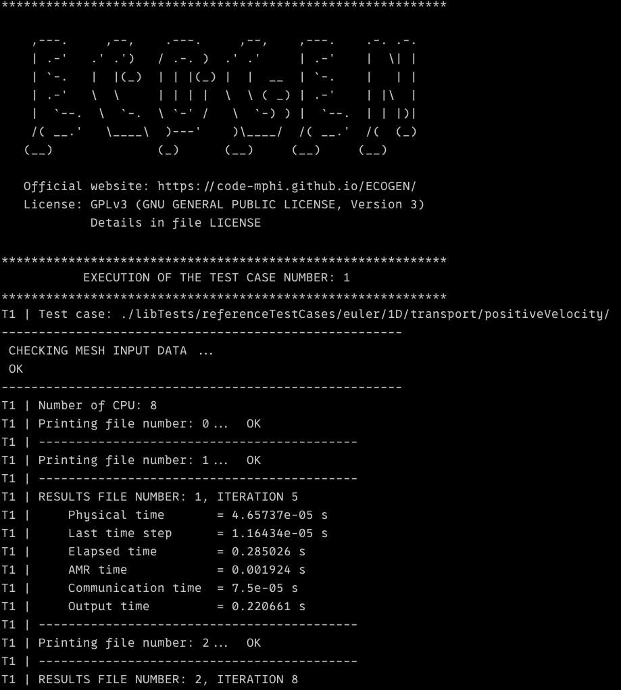

.. _Sec:IO:output:

Output Files
============

Writing the result files is done according to the user’s choice in *main.xml* input file of the current test (see section :ref:`Sec:input:main`). For each run, the results are recorded in the specified folder **ECOGEN/results/XXX/** where XXX is the test case *name*.
One can select the following format:

- *GNU*: Format in ASCII, results are given in column.
- *VTK*: VTK file format (ASCII or binary).
- *VTKHDF*: VTKHDF file format (binary).

The result files are placed within the **ECOGEN/results/XXX/datasets/** subfolder.

*GNU* and *VTK* filenames follow the rules:

.. centered:: `result(format)_CPU(proc)_TIME(instant).(ext)`

where the variables are:

- (format): Data format (empty for ASCII, B64 for binary).
- (instant): Timestamp of the written result (depends on the selected frequency for writing).
- (proc): The core number where the results are from (in the case of a parallel simulation).
- (ext): Type of mesh.

*VTKHDF* filenames follow the rules:

.. centered:: `result_TIME(instant).vtkhdf`

Using GNU format
----------------
This format leads to result files with the *(ext)=out* extension. This format in column is very useful for a quick visualization of the results using the freeware `gnuplot`_ or any other tool. When this format is selected, ECOGEN automatically creates a script file *visualization.gnu* at the root of the result folder. This allows a very quick and efficient use for 1D runs.

XML VTK file format
-------------------
ECOGEN can provide output using XML files in VTK file format (ASCII or BINARY). Writing files in VTK file format leads to files with the extension:

- *(ext)=vtr*: Cartesian mesh.
- *(ext)=vtu*: Unstructured mesh.

ECOGEN also produces files named *collectionParaview.pvd* and *collectionVisIt.visit* (or *collectionParaviewB64.pvd* and *collectionParaviewB64.pvd* for BINARY) in order to load only one pack of files when the software `ParaView`_ and `VisIt`_ are used, respectively.

VTKHDF file format
------------------
ECOGEN can provide HDF5 outputs at VTKHDF file format. Writing files in VTKHDF file format leads to files with the *vtkhdf* extension.
For now, all meshes, whatever their type, are saved at unstructured file format.

ECOGEN also produces a file named *timeseriesParaview.vtkhdf.series* in order to directly load one pack of files in *Paraview*. For old versions of ParaView, it is required to disable the `Merge Parts` option (enabled by default) in the Properties section of the Paraview GUI to avoid a deadlock when visalizing the file.

Note that VTKHDF outputs are less efficient than XML VTK outputs on a small number of MPI processes. They have to be used for test cases where XML VTK outputs would create more than about 10000 files in the dataset folder, thus, when the number of MPI process times the number of time steps written approaches or exceeds 10000. In this case the file system may saturates or crash due to the very large number of files to manage and VTKHDF outputs have to be prefered.

Saving input files
------------------
In addition to the results, a copy of the input files of the current simulation is done in the subfolder **ECOGEN/results/XXX/savesInput/** to ensure a safe reproduction of the results.

Probes and cuts
---------------
All the output files linked to the probes and cuts of the simulation are placed within the subfolders **ECOGEN/results/XXX/probes/** and **ECOGEN/results/XXX/cuts/**, respectively.

Mesh information
----------------
When using AMR, mesh information is saved at a frequency specified in the *main.xml* file to allow a resume of the simulation and the corresponding files are placed within the subfolders **ECOGEN/results/XXX/infoMesh/**:

  - *domainDecomposition_TIME<n>.out* files contain informations on the parallel domain decomposition,
  - *treeStructure.\*_TIME<n>.out* files contain the subdivision status of each cell of the mesh (0 for non splitted, 1 for splitted):

    - when using GNU or VTK output file format, one ASCII file, named *treeStructure_CPU
_TIME<n>.out*, is saved per MPI process and per time step. It contains only the subdivision status of each cell of the mesh.
    - when using VTKHDF output file format (so in context of a large number of MPI processes), only one binary file, named *treeStructure_TIME<n>.out*, is saved per time step. It contains, first, the cell count per mpi process in order of ascending rank, and second, the status of the cells of the mesh of each process (still in order of ascending rank). To inspect the content of this file, use:

     .. code-block:: sh

       od -i treeStructure_TIME<n>.out -p

Screen output
-------------
In real time, some data are available during the simulation directly at the terminal screen as soon as ECOGEN starts. Hereafter is an example of a screenshot:

  : Screenshot of the top of ECOGEN's default run console.

One reads:

- number of the result files,
- number of the last timestep,
- physical time in the simulation,
- value of the last timestep,
- CPU time since the beginning of the simulation,
- CPU time spent in AMR routines since the beginning of the simulation,
- CPU time spent writing the main output files (mesh and solution fields) since the beginning of the simulation.

Screen output backup: `infoCalcul.out` file
-------------------------------------------

The *infoCalcul.out* file is saved at root of the output directory. It is needed to resume or restart a simulation and contains the data displayed in the terminal output, so:

- first, the number of mpi processes that have been used to run the simulation,
- then, at the wanted output frequency:

  - the number of the result files,
  - the number of the last time step,
  - the physical time in the simulation,
  - the value of the last time step,
  - the CPU time since the beginning of the simulation,
  - the CPU time spent in AMR routines since the beginning of the simulation,
  - the CPU time spent writing the main output files (mesh and solution fields) since the beginning of the simulation.

.. _gnuplot: http://www.gnuplot.info/
.. _ParaView: https://www.paraview.org/
.. _VisIt: https://wci.llnl.gov/simulation/computer-codes/visit/
