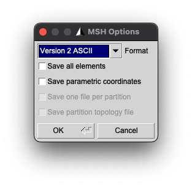
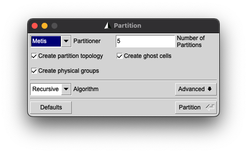

.. role:: xml(code)
  :language: xml

.. _Sec:tuto:exportGmshFile:

*****************************************
Export Gmsh mesh to version 2 file format
*****************************************

Since, in parallel, ECOGEN supports only Gmsh_ :cite:`geuzaine2009gmsh` **version 2** mesh files, and the latest Gmsh software currently uses **version 4** by default, we recommend exporting the mesh file to **version 2**.

Mesh generation using graphical interface
=========================================

To generate a mesh from Gmsh graphical interface, use `File -> Export`, choose `Gmsh version 2 ASCII` format and make sure additional options **are not** checked.

.. _Fig:tutos:exportGmshFile:export:

  Gmsh export window.

If the mesh has to be partitioned, check also the option `Create ghost` cells to have a mesh file fully compatible with ECOGEN.

.. _Fig:tutos:exportGmshFile:partition:

  Gmsh partition window.

Mesh generation using command line interface
============================================

To generate a mesh from Gmsh command line interface, enter the following command:

.. highlight:: console

::

   gmsh -<d> -format msh22 <PATH_TO_FILE>

where `<d>` has to be replaced by the mesh dimension (`1` for a 1D mesh, `2` for a 2D mesh and `3` for a 3D mesh) and `<PATH_TO_FILE>` by the path and name of the `.geo` file.

You can partition the mesh into `n` partitions and ghost cells with following command:

.. highlight:: console

::

   gmsh -<d> -format msh22 -part <n> -part_ghosts <PATH_TO_FILE>

You can get help on available command line option with `--help` argument:

.. highlight:: console

::

   gmsh --help

.. _Gmsh: http://gmsh.info/
